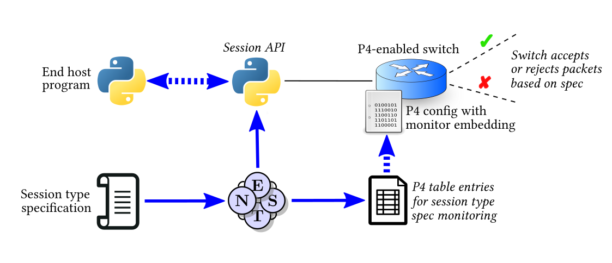
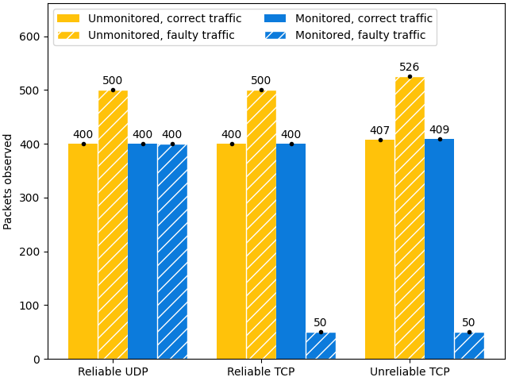

# NEST: Network Enforced Session Types

This artifact contains NEST, the tool presented in the ECOOP'26 paper **"NEST:
Network Enforced Session Types"**. Other than the tool itself, this artifact
includes an evaluation suite for demonstrating its functionality; the results of
the evaluation are documented in the paper.

This README contains the following sections:

  1. __Introduction__: A brief overview of NEST and the concepts it uses.
  2. __Kick-The-Tires__: Instructions for setting up the artifact and making sure basic functionality works.
  3. __Reproducing results__: Instructions for how to replicate the results shown in the article.
  4. __Documentation__: A more detailed explanation of NEST's components and how NEST is used.

## 1. Introduction

NEST is a tool for synthesizing network-level monitors from application-level
protocols. NEST makes use of the following concepts:

* **Session types**: Specifications of communication protocols between processes
  in a message-passing system. Each process is assigned a _role_ in a multiparty
  interaction, and a session type specifies how a role  should send/receive
  messages to/from other roles, possibly with choices and recursion.

* **P4**: A domain-specific language (DSL) for programming network switches. It
  can be used to specify custom packet headers, tables for matching and
  processing network packets, packet operations, and more.

NEST itself is a Scala 3 library that takes as input a set of session types
describing the communication protocol between processess running on the end
hosts of a networked system. Each session type is represented as an instance of
a data type in an embedded Scala 3 DSL.

NEST produces as output:

1. A set of P4 session monitors, i.e., P4 table entries that accept or reject
   packets depending on whether they conform to the expected session type
   behaviour; and

2. A Python API for writing communicating programs that send/receive the
   messages specified in the input session types. The API is quite simple and
   (by design) does _not_ enforce sending/receiving messages in a predetermined
   order. Behind the scenes, the Python API constructs and parses network
   packets containing the headers that the NEST P4 monitors inspect. (If such
   headers are missing, the NEST monitors would just drop the packets.)

The NEST workflow is illustrated in figure 4 from the article, also shown below:



## 2. Kick-The-Tires

To test the basic functionality of the artifact, you will need to import the
Open Virtual Appliance (OVA) package `vm/nest.ova` in a virtualization program
(e.g., [VirtualBox](https://www.virtualbox.org/)) and launch the corresponding
VM. 

**Optionally**, you can generate a new VM by using
[`Vagrant`](https://developer.hashicorp.com/vagrant). This may take 30-60
minutes, and is generally not needed (i.e., you can skip to _"Once the VM has
started..."_ below).

```
cd vm/
vagrant up   # Wait until the VM is fully configured, reboots, and shows
             # a graphical login prompt
```

**Once the VM has started** and you see the graphical login interface, you can
access the system:

* username: `NEST`
* password: `sdn`

Inside the VM, start a terminal (pressing `Ctrl` + `Shift` + `T`) and run:

```
make kick_the_tires
```

This will run the `BookInfo` example described in the paper, executing each
configuration variant once (correct/faulty traffic, UDP/TCP protocol, etc.),
then display a bar plot with the results (i.e., number of packets observed in
each configuration).

The run should take around **5 minutes** (slightly longer if using a fresh VM
image where `sbt` is not set up), and the resulting bar plot should look similar
to the one below (the numbers for TCP may vary slightly). If it does,
the kick-the-tires phase has been successful!



## 3. Reproducing the results in the paper

_**NOTE**: the times below are estimated with the VM running on an Intel Core
i7-1185G7 CPU @ 3Ghz (4 cores, 8 hyper-threads, 3GHz) with 32 GB RAM._

Our paper presents the following main results:

 1. The bar plots shown in Figure 13 and Appendix C
 2. The time series shown in Figure 14
 3. The statistics shown in Table 2

The measurements at the basis of those figures and tables can be performed by
running one of the following commands:

* **Option 1: reduced evaluation** (estimated time: 45 minutes)

  ```
  make test_all_examples RUNS=1
  ```

* **Option 2: full evaluation** (estimated time: 4 hours)

  ```
  make test_all_examples RUNS=5
  ```

In the commands above, `RUNS=n` specifies the number of repetitions for each
example (used for computing medians and deviations). Higher values of `n` give
more confidence in the results, but take longer to run.

After the measurements terminate, you can reproduce the results in the paper as
follows.

### 3.1. Reproducing the bar plots in Figure 13 and Appendix C

Please run:

```
make show_all_barplots RUNS=n
```

where `RUNS=n` should match the value used for the measurements above -- i.e.,
either `RUNS=1` (reduced evaluation) or `RUNS=5` (full evaluation).

The resulting bar plots display the median values, with the variance depicted as
a black dot/line at the top of each bar. The bar plots should be very similar to
those in the paper; in the case of TCP there may be some slight variations due
to some nondeterminism in packet delivery speed, loss, retransmission, and
reordering.

### 3.2. Reproducing the time series in Figure 14

The time series in Figure 14 depicts the number of packets observed during one
execution of the examples. To reproduce such plots, please execute:

```
python3 testing/parser.py <EXAMPLE> timeseries <X>
```

where:

- `<EXAMPLE>` is any of the directory names under `examples/` (the plots in
  Figure 14 use `bookreview` and `vpn`); and
- `<X>` is which run to display (i.e., any number between 1 and the number of
  runs `RUNS` used in Section 3 above).

Specifically, to reproduce Figure 14.a and 14.b, use:

```
python3 testing/parser.py bookreview timeseries 1
```

and to reproduce Figure 14.c and 14.d, use:

```
python3 testing/parser.py vpn timeseries 1
```

Note that each of these commands will show _three_ plots: one for UDP, one for
reliable TCP, and one for unreliable TCP. However, _only the last two plots_
(reliable/unreliable TCP) are shown in Figure 14 of the companion paper.

The generated plots may show slight differences w.r.t. the companion paper due
to the nondeterminism in packet delivery speed, loss, retransmission, and
reordering. Specifically, the expectation is that:

- Each line in the plot should reach maximum y-axis values that are similar to
  the corresponding values in the companion paper;
- Each line of the plot may stop earlier or later along the x-axis w.r.t. the
  companion paper. This is because the plots stops when all expected packets are
  delivered or the benchmark times out (in case of faulty TCP traffic in a
  monitored network) -- hence, the stopping time of the time series depends on
  packet delivery scheduling and system speed.

### 3.3. Reproducing Table 2

Please run:

```
make print_all_stats RUNS=n
```

where `RUNS=n` should match the value used for the measurements above -- i.e.,
either `RUNS=1` (reduced evaluation) or `RUNS=5` (full evaluation).

The reproduced table shows the median results between all runs; in the case of
TCP there may be some slight variations w.r.t. the table shown in the paper, due
to some nondeterminism in packet delivery speed, loss, retransmission, and
reordering.

## 4. Documentation

The file [DOCUMENTATION.md](./DOCUMENTATION.md) details the artifact structure
and includes more details on the NEST usage and internals.
